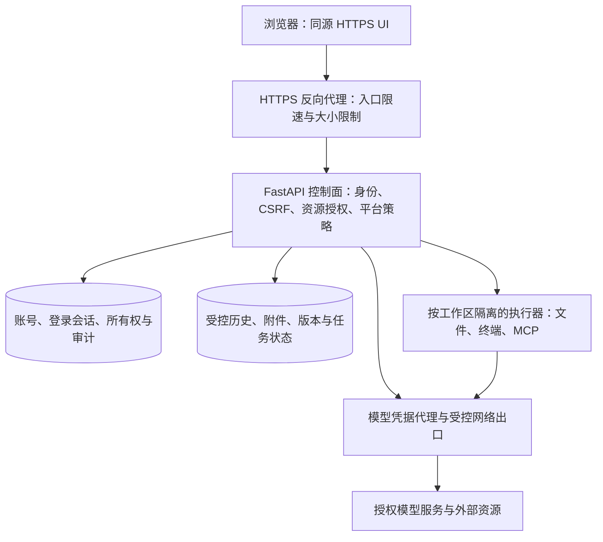

# 用户账号与远程部署安全方案

日期：2026-10-24。状态：**源码检查与待实施方案，不代表以下能力已经实现。**

实施进展更新：账号、授权与 Linux 部署入口已落地，当前行为、验证和启用步骤见 [安全实施说明](security_implementation.md)。下文保留为实施前检查快照；不可信用户的 OS 执行隔离仍需独立建设。

## 1. 结论与推荐范围

当前项目按本地、单一可信使用者设计。远程部署需要同时补齐：**身份认证、资源所有权、平台权限上限、工具执行隔离、网络与浏览器防护、审计与运维**。

推荐目标为“同源 HTTPS 的自有服务器、小团队账号、默认私有数据”。第一版采用**管理员创建账号 + 服务端登录会话 + 工作区权限**，关闭公开注册；以后有统一身份平台再增加 OIDC 登录。

上线分两种门槛：

- **单一可信管理员的远程实例**：专用虚拟机、低权限服务账号、HTTPS、登录/MFA、入口与高危接口保护完成后可先使用。该管理员被明确视为实例执行环境的可信操作者。
- **相互不信任的多账号实例**：资源所有权与执行环境隔离全部完成后才能开放工具执行。多个账号共享服务进程的 OS 身份与全部数据目录，不能提供所需的数据隔离。

如需现在远程访问，过渡部署先用 VPN/受控入口、关闭后端公网端口；本轮没有替服务器执行这些配置。

## 2. 检查范围与证据限制

本次静态检查覆盖 `main.py`、13 个已挂载路由模块及路由辅助模块、权限与审批、会话 worker、终端任务、模型/MCP 配置、上传/导入/预览、前端 API/Markdown/Canvas 入口、依赖和部署说明。

静态提取到 **129 个显式 HTTP 路由**，详见 [逐路由清单](security_route_inventory_2026-10-24.csv)。另有框架生成的 `/docs`、`/redoc`、`/openapi.json` 和整个 `/ui` 静态挂载。清单记录当前声明位置及建议授权类别；最终实施还必须检查中间件、每个请求参数和下层服务调用，不能仅据路由名称判断权限。

本轮没有启动应用、请求实际危险接口、读取真实密钥或聊天内容、探测公网、防火墙、反向代理或执行漏洞扫描。下列结论是代码层事实及风险推导；无法据此断言当前机器已经被公网访问或已经发生泄露。

## 3. 已有的安全基础

应保留并扩展现有机制：

- 工具审批已有参数摘要、epoch、执行账本、恢复检查点；终端任务校验会话与日志文件路径。
- 上传已有流式单文件限制；JSONL 导入上限 20 MiB；分享包已有大小、条目和解压总量检查。
- Markdown 先转义 HTML；SVG 使用 DOMPurify；Canvas 使用不给 `allow-same-origin` 的脚本沙箱。
- 模型列表使用 `api_key_present`，没有直接返回 provider API Key；MCP 诊断已有部分敏感字段脱敏。
- 模型连接保留 TLS 证书与主机名验证；依赖已有锁文件；敏感数据路径加入 `.gitignore`。

这些措施分别解决局部问题，账号、HTTP 资源授权和系统执行边界仍需补齐。`.gitignore` 只影响版本管理，不能保护运行时文件、接口或备份。

## 4. 发现的问题与优先级

P0 为对外开放前的阻断项；P1 应在相应功能开放前完成；P2 为后续持续加固。影响均以攻击者能够到达相关入口为前提。

| 编号 | 级别 | 代码事实与影响 | 证据 |
| --- | --- | --- | --- |
| S01 | P0 | 没有统一账号登录、当前用户依赖或默认拒绝的 API 认证层。服务绑定地址的代码默认值为 `0.0.0.0`，实际可达性取决于部署。 | `main.py:46–119`；`config.py:17` |
| S02 | P0 | 权限模式修改、审批决定、任务恢复/取消没有账号身份检查；调用者可申请或批准能力。现有审批确认的是工具操作，尚未确认谁有权审批。 | `routers/tool_approval_router.py:54,157,194` |
| S03 | P0 | MCP 诊断的 `action=call` 直接调用已配置工具，没有经过聊天工具审批流程。其实际影响由已配置 MCP 服务能力决定。 | `routers/tools_manage_router.py:41` |
| S04 | P0 | 资源主要按客户端传入的 `session_id`、任务 ID、文件 key 查找，没有账号所有权关系。列表/搜索/状态汇总也是实例级数据。增加登录后仍须逐资源授权。 | `routers/chat_router.py:278–320`；`routers/terminal_router.py:11`；`factory/agent_runtime/command_jobs.py:27` |
| S05 | P0 | 本地文件读取入口支持绝对路径；询问模式依赖当前工作目录和预览票据，`full_control` 放宽限制。配置修改入口未认证时，这些限制可被同一 HTTP 调用者改变。 | `routers/file_router.py:470`；`routers/tool_approval_router.py:54` |
| S06 | P0（多租户） | 会话 worker 通过进程与 `chdir` 切换目录；终端/MCP 子进程继承服务身份与环境，没有独立 OS 用户、容器或文件系统边界。可执行脚本的用户可能访问同服务身份可读的其他账号数据与配置。 | `factory/session_worker.py:281`；`factory/agent_runtime/builtin_tools.py:3124`；`util/mcp_client.py:114` |
| S07 | P1 | 当前保护资源列表没有覆盖所有秘密，例如 `setting/models.json`。当这些文件位于可读工作目录中时，单纯的目录内允许策略不足以保护密钥。 | `factory/agent_runtime/permission_policy.py:40` |
| S08 | P1 | CORS 为任意来源、任意方法/头，且设置允许凭据；没有统一 CSRF、Host 和 Origin 策略。当前匿名 API 不需要 Cookie 即可被调用，不能依赖浏览器对通配符凭据的限制。 | `main.py:84–95` |
| S09 | P1 | “用户资料”实际为全局 `.env USER_NAME`，没有账号、密码、角色或独立资料；返回值包含环境文件路径。模型选择/角色配置还能携带自定义 headers，敏感值需要单独审查和脱敏。 | `routers/user_profile_router.py:1,60`；`routers/chat_config_router.py:1187`；`config.py:151` |
| S10 | P1 | 外部媒体代理允许 HTTP(S) 来源，虽禁重定向并限 32 MiB，但未见统一目标网络策略。模型端点、MCP 与终端也能发出网络请求。 | `routers/tool_approval_router.py:212–243`；`util/mcp_client.py`；`chat/chat_llm.py` |
| S11 | P1 | 预览可按扩展名或上游 Content-Type 在应用同源返回内容；HTML/SVG 等主动内容需要隔离。Canvas 的 ready 分支检查消息来源，其余消息分支还需绑定来源窗口与运行 ID。这里识别的是风险入口，未进行浏览器攻击复现。 | `routers/tool_approval_router.py:242`；`memory/file_memory.py:1565`；`H5/js/app/messages.js:3944` |
| S12 | P1 | 预览票据使用随机进程内密钥，绑定会话与来源、有效期 30 分钟；没有用户/工作区主体。它是局部预览授权，不是登录认证；多进程和撤权语义也需重新设计。 | `routers/permissions_auth.py:1–29` |
| S13 | P1 | 有单次上传、任务预算和部分并发限制，但没有账号级资源总额、入口限速或全实例统一资源保障。聊天入口先读取 JSON，需在解析前限制总字节。 | `routers/raw_upload.py:17`；`routers/chat_router.py:122`；`routers/task_cost_router.py` |
| S14 | P1 | 部分 GET 可引发昂贵操作或状态变化，例如强制刷新工具列表会探测/启动 MCP 服务。登录后必须避免跨站 GET 触发这类操作。 | `routers/tools_manage_router.py:65` |
| S15 | P2 | 应用挂载整个 H5 目录，正式部署需缩小到发布资源；未见统一安全响应头和安全审计。锁文件本身不代表没有已知漏洞，本轮未对依赖做 CVE 结论。 | `main.py:119`；`util/ui_cache.py`；`requirements.lock.txt` |

### 4.1 主要风险路径

需要重点切断的路径是：未认证 HTTP 请求 → 修改执行策略/提交 MCP 调用 → 执行环境内文件或命令能力 → 读取服务身份可访问的数据。

多账号上线还必须切断：已登录用户 A → 指定 B 的资源 ID，或从自己的终端访问共享数据根目录 → 获得 B 的数据。难猜的会话 ID 和前端隐藏按钮都不能替代后端授权。

## 5. 推荐架构

- 控制面管理账号、配置、历史、权限和模型凭据，不挂到用户终端可访问的目录中。
- 执行器只得到获准工作区、当前任务必要资源与最小环境变量。历史/附件按授权显式传入，不把全部 `history_files` 挂给执行器。
- 账号授权与原有工具审批叠加：**平台能力上限 ∩ 工作区授权 ∩ 任务授权 ∩ 本次审批**。用户自己的审批也不能解除平台禁止项。
- 当前单机优先保留单个 API 控制进程。已有活动流、worker 映射和部分状态保存在进程内，不能直接增加 Uvicorn workers 作为多机方案；横向扩展前需共享任务协调、事件和撤权状态。

## 6. 账号、角色与资料

### 6.1 第一版功能

管理员创建/禁用账号、重置密码、分配工作区和角色；用户登录、退出、修改自己的资料/密码、查看与撤销登录设备；管理员查看安全审计。

- 默认关闭公开注册；邀请功能以后增加，使用短期单次凭证。
- 首个管理员由本机 CLI 交互创建，无默认密码；数据库初始化与首账号创建有并发锁。数据库缺失、损坏或没有管理员时进入受限初始化/维护状态，不能自动退回匿名访问。
- `user_id` 使用不可变随机 ID。用户名有规范化后的唯一索引，显示名与登录标识分开；编辑显示名不能改变身份。
- 原 `GET/POST /user/profile` 保留资料能力，改为当前账号的数据；移除 `env_file/env_value` 等平台细节。旧 `USER_NAME` 只作为管理员显式迁移时的显示名来源。
- 账号采用禁用/软删除保留审计关联，不能把其历史资源自动重新分给下一个注册用户。

### 6.2 权限划分

| 能力 | 普通成员 | 可信执行操作员 | 平台管理员 |
| --- | --- | --- | --- |
| 自己的资料、会话、附件 | 按所有权 | 按所有权 | 按所有权/明确授权 |
| 查看共享工作区 | 需要显式 read 授权 | 需要显式授权 | 需要显式授权 |
| 编辑或执行工作区任务 | 需要 write/execute 授权，且执行器已隔离 | 在批准的能力范围内执行 | 可以分配能力，操作仍受审计 |
| 放宽自己的审批偏好 | 仅在平台允许范围内 | 同左 | 配置平台上限；不能用前端参数越权 |
| 修改主机目录、模型端点/密钥、MCP 配置 | 禁止 | 默认禁止 | 二次验证后管理 |
| MCP 诊断调用与强制发现 | 禁止 | 只在专门授权的测试工作区 | 受控诊断、审计、二次验证 |
| 账号管理、全局预算/计价、日志审计 | 禁止 | 禁止 | 允许，敏感操作二次验证 |

角色负责粗粒度能力，所有权和工作区 ACL 决定具体对象；共享细分 read/write/execute/approve，不能共享一个对象就自动共享全部权限。管理员默认界面不直接展示所有私有聊天，支持访问可做单独授权与审计；实际 OS/实例管理员仍属于可信根。

### 6.3 密码、MFA 与恢复

- 密码使用成熟库实现的 Argon2id，保存算法与参数，登录成功后按需要升级哈希。OWASP 当前最低配置之一为 19 MiB、2 次迭代、并行度 1；实际参数在目标服务器校准，不能在异步事件循环里执行昂贵哈希，应放到有并发上限的工作线程。[密码存储建议](https://cheatsheetseries.owasp.org/cheatsheets/Password_Storage_Cheat_Sheet.html)
- 建议第一版统一最少 15 字符、允许至少 64 字符（可取 128），支持粘贴与密码管理器，限制极端输入字节量；不做固定字符种类拼凑或无理由定期强制改密。密码不写明文、不进入日志、不静默截断。
- 公网可用的管理员和执行操作员要求 MFA。第一版可做 TOTP 与一次性恢复码；TOTP 秘钥加密保存，恢复码单向保存，限制重放与尝试次数。以后可增加 WebAuthn/Passkey。
- 创建管理员、重置密码、修改角色/密钥/执行上限、禁用 MFA 等需近期二次验证；普通每次工具调用不重复弹登录确认，沿用任务审批机制。
- 登录失败使用统一错误和等价哈希路径，按账号与可信来源 IP 共同退避。限速应限制并发内存开销，避免 Argon2 本身变成拒绝服务入口。
- 账号恢复通过管理员或本机 CLI；恢复凭证短期、单次、仅保存验证值。管理员重置后强制用户设置新密码并撤销旧登录，不能返回原密码。

## 7. 登录会话、CSRF 与前端

### 7.1 推荐会话方式

浏览器使用服务端会话，Cookie 仅携带随机凭证，服务端保存其验证哈希、账号、有效期与撤销状态。建议 32 字节随机 secret；密码使用慢哈希，随机高熵会话 secret 可使用 SHA-256 验证值。

命名上区分 `login_session_id`（登录状态）与现有 `session_id`（聊天标识），聊天标识不能用作认证凭证。

生产 Cookie 建议：`__Host-ytools_session; Secure; HttpOnly; SameSite=Lax; Path=/`，不设置 `Domain`。登录及提权轮换凭证；退出、改密、封禁、恢复与管理员撤销均有清晰失效策略。暂不向浏览器发行长期 JWT，也不把登录凭证存进 localStorage、sessionStorage 或 URL。[会话管理参考](https://cheatsheetseries.owasp.org/cheatsheets/Session_Management_Cheat_Sheet.html)

初始可配置建议：普通登录空闲 30 分钟、绝对 12 小时；管理员更短。它们是本项目建议值，不是通用标准，实施时要验证长任务与浏览器休眠体验。

### 7.2 HTTP 和浏览器边界

- 所有业务 API 默认要求登录；登录/必要初始化、最小健康检查与公开 UI 构建资源使用严格小型白名单。框架文档与 OpenAPI 仅内网或管理员可用。
- Cookie 认证的状态改变请求同时校验 CSRF token 与可信 Origin/Referer；登录也防止 login CSRF。`SameSite` 是补充防护，不能替代 CSRF。[CSRF 参考](https://cheatsheetseries.owasp.org/cheatsheets/Cross-Site_Request_Forgery_Prevention_Cheat_Sheet.html)
- 远程生产前后端统一同源，默认关闭跨域；确需跨域时列出完整可信 origin，禁止任意来源、`null` 来源和从 `file://` 页面连接远端生产 API。
- 合法 CORS 预检只返回必要协议头，实际业务请求仍需鉴权与授权；不能把 OPTIONS 成功视为已登录。
- 校验 Host；只信任反向代理来源网段转发的客户端地址和协议头。不能因为后端看见 `127.0.0.1` 就绕过认证，反向代理也可能以这个地址连接。
- 采用能保留 SSE 流式行为的 ASGI 认证层，鉴权失败时在读取大请求体和启动任务前拒绝；路由/服务层再检查具体对象权限。
- `H5/js/api.js` 统一处理同源 Cookie、CSRF、401、403、429；另行覆盖直接 fetch 的 SSE、上传、下载和恢复入口。媒体元素与 Range 请求也要先鉴权，不能只保护 JSON API。
- 生产页面固定使用当前站点 origin，迁移或忽略旧的 `ytools-api-base` 覆盖值，避免登录页面与实际 API 意外连接到不同实例。
- UI 增加登录页、退出/设备会话、个人资料、管理员账号列表；按钮是否可见只改善体验，后端始终验证权限。
- localStorage 中的会话列表、草稿、历史、编辑状态按 `user_id` 分区；退出/切换账号清理敏感内存、DOM、Blob URL 和缓存，不在同一浏览器里展示上个账号的数据。

## 8. 所有权与数据模型

建议单机第一版新增身份与所有权数据库，SQLite WAL 即可；已有聊天 JSONL、文件版本和恢复 journal 先保留，避免为账号功能一次重写全部存储。

| 表/实体 | 必要字段 |
| --- | --- |
| users | id、login_normalized（唯一）、display_name、password_hash、status、auth_version、创建/更新时间 |
| login_sessions | public_id、secret_hash、user_id、idle/absolute expiry、revoked_at、MFA/近期验证状态 |
| user_roles / workspace_members | 用户、角色/工作区、具体能力、版本 |
| workspaces | id、owner、受控根目录/执行器标识、平台、执行与出网策略、限额 |
| resource_owners | 类型、内部资源 ID、owner_user_id、workspace_id、创建状态；资源类型与 ID 有唯一约束 |
| security_audit_events | actor、动作、对象、结果、可信来源、request_id、时间、必要的批准人信息 |
| user_secrets（需要个人凭据时） | owner、用途、加密值/秘密管理器引用、密钥版本；不与模型上下文一起挂载 |

必须覆盖的资源包括会话、分组、归档、上传/缩略图、文件版本、终端任务/日志、权限任务/审批、任务模板/运行记录、预算/用量、模型/提示词偏好、导出包，以及 Messages/Responses 原生状态。不能只给聊天表增加 `user_id`。

关键规则：

1. HTTP 主体从服务端登录状态取得，客户端提交的 owner、角色、使用标签、内部协议状态均不能决定身份或权限。
2. 每个读取/写入/停止/恢复/下载入口由服务层验证对象所属；列表、全文搜索、总数、运行状态汇总先按主体过滤，再分页/计数。
3. 不允许通过请求一个未知旧 `session_id` 自动取得其所有权。新资源由服务端注册；若需兼容前端生成 ID，必须映射到当前用户的内部 ID，不能直接覆盖磁盘同名会话。
4. 前端获得的资源 ID 与真实文件路径分开；随机 ID 只减少猜测，权限检查仍必须执行。[授权参考](https://cheatsheetseries.owasp.org/cheatsheets/Authorization_Cheat_Sheet.html)
5. 文件写入和所有权登记跨 JSONL/数据库，使用 pending → 原子落盘 → active 的受控提交及孤儿恢复流程。没有已激活所有权的对象默认不可访问。
6. 所有权无法确定、数据库异常、撤权状态无法验证时安全拒绝；不能回退为全实例数据。
7. 共享/复制/导入只迁移被允许的数据，不继承来源账号、凭证、主机目录、`full_control`、审批 grant 或原生远端链。
8. 模型选择可以在授权模型目录内由用户设置；端点、认证 headers、全局密钥与 MCP 配置归管理员。模型选择回显只返回安全字段与“已设置”标记。

## 9. worker、后台任务与撤权

- 创建任务时由服务端写入可信 `user_id/workspace_id/task_id/capabilities/policy_version`；通过内部 IPC/受控任务通道传给 worker。请求 DTO 与内部执行 DTO 分开，拒绝客户端伪造这些字段。
- worker、子智能体、终端、MCP、历史与预算层都使用可信执行上下文；恢复任务先验证当前账号、资源所有权、能力和审批代次，保留现有去重与不确定执行处理。
- 网络断开、标签页关闭、登录空闲过期默认不取消已经授权的后台任务。重新登录同账号后，重新授权附接 SSE。
- 普通退出撤销该登录并停止该登录的可见流，不自动杀掉独立后台任务；UI 明确说明这一行为。
- 账号封禁、工作区执行权限撤销和明确的安全事件处置要阻止新操作，并在下一工具边界阻断/暂停任务。提供“封禁并停止任务”的显式管理动作；已执行的外部操作不可假装回滚，终端停止失败或结果不确定必须记录。
- SSE 在建立连接时鉴权，并利用撤权事件/有限周期复查在目标 5 秒内关闭失效登录的流。后台执行授权独立校验账号与工作区能力，避免登录过期把正常长任务误判为非法。
- 改密/登出全部设备默认撤销登录；若因账号被盗，应选择同时撤销任务执行租约。保留“登录授权”和“已提交后台任务授权”的区别，不能让失效浏览器继续控制任务。
- 单请求共享一次认证结果，资源查询有索引，撤权使用版本与短期缓存；不要每个 SSE token 查询数据库。沿用 `API latency`，把新增认证开销纳入基准，建议缓存命中鉴权 p95 目标 5ms 以内，并按机器实测调整。

## 10. 文件、终端与 MCP 隔离

### 10.1 执行器

Linux 服务器优先采用按工作区隔离的 rootless 容器或独立 OS 身份；不互信或高风险代码优先独立虚拟机/微虚拟机。容器不是绝对隔离，仍需更新内核与运行时。

现有 `session_worker` 同时加载全局模型配置并负责模型编排，实施时需先拆分可信编排与不可信工具执行。隔离区通过受控执行接口接收工具任务，不加载控制面的 `.env/models.json`；若把整个 Agent 放入隔离区，模型调用也必须经过凭据代理。

- 只挂载当前获准工作区及必要输入；控制面代码、全部聊天根目录、认证库、宿主 `.env`、模型密钥、SSH 凭据和容器管理 socket 不挂载。
- 低权限身份、禁止提权、受控系统调用/能力、只读基础系统；按工作区限制 CPU、内存、进程数、磁盘、日志与执行时长。
- 子进程环境采用允许清单并提供任务专属 HOME/TMP。改变现有“尽量继承完整环境”的默认时，要验证 Python/Node、PATH、编码、代理与 PTY 功能。
- 执行器使用短期、任务范围的代理凭证调用获准模型/服务，不能获得全局 provider Key。MCP 确需第三方凭据时按服务/工作区独立最小授权。
- 模型返回、附件文字和网页内容均为不可信输入，不允许它们赋予自身审批或平台管理能力；审批卡片显示来源和真实目标范围。

### 10.2 文件接口

- 远程模式关闭普通用户的任意主机绝对路径读取；改为 asset ID、工作区内相对路径或预先授权的文件句柄。
- 保护范围不能只靠几个文件名，最终由挂载、OS ACL 和后端策略共同限制。路径检查覆盖符号链接、Windows junction/reparse point、大小写/UNC/设备路径及文件替换竞态。
- 预览、原文件、缩略图、版本回退、日志下载、批量导出都先检查所有权，HEAD/Range/304 也不能泄露其他账号对象是否存在或内容。
- 导入包创建为当前账号的新资源；覆盖已有资源时另查 write 权限，且不能通过导入权限数据库或模板取得更高执行权限。

### 10.3 MCP 与出网

- 全局 MCP 服务/配置由管理员管理；普通用户只看到获准工具目录。诊断工具调用只能在受控管理/测试工作区运行，不能绕过正常执行策略。
- 有状态 MCP 连接、浏览器 profile、工具客户端和缓存按工作区/凭据边界隔离。无状态 HTTP TCP 连接的复用本身不等于共享账号；重点检查 Cookie、授权头、provider state 和浏览器会话是否被复用到错误主体。
- 外部媒体、网页抓取、模型端点、MCP HTTP 与重定向统一执行目标策略；处理 IPv4/IPv6、回环、私网、链路本地、云元数据、DNS 重绑定以及重定向后的地址。单纯字符串前缀判断不足。
- 确需本地 Ollama、企业内网服务时，由管理员批准精确服务/端口，不能为此放开全部内网。
- 任意代码执行可自行构造网络请求，所以出网策略必须在执行器网络层或受控代理层生效。禁止绕过代理直连元数据和其他租户网段。[SSRF 参考](https://cheatsheetseries.owasp.org/cheatsheets/Server_Side_Request_Forgery_Prevention_Cheat_Sheet.html)

## 11. 上传、预览与浏览器主动内容

- 保留现有上传上限，再增加账号/工作区总容量、并发、日累计与处理资源限制；聊天 JSON 在解析前限制字节量，不只依赖 Content-Length。上传与解析分别限流。
- 扩展名、MIME 与文件特征结合校验，服务端生成存储名，文件存放于非 Web 根目录。压缩包限制条目、解压总量与比例；PDF/Office/图像解码放在有限资源的处理器里，禁用不必要外部资源访问。[上传参考](https://cheatsheetseries.owasp.org/cheatsheets/File_Upload_Cheat_Sheet.html)
- 未知/主动内容默认下载；HTML/SVG/不可信文档预览使用无应用 Cookie 的独立 origin，或禁脚本的严格沙箱。不能直接信任上游 Content-Type 并在应用同源执行。
- 媒体访问优先使用当前登录 Cookie + 对象授权；确需临时 URL 时，票据绑定用户/资源/动作/策略版本、短期失效，并考虑 Range 多次读取，避免把整段下载错误设计成仅允许一次请求。
- 临时票据不要携带可读主机路径；日志不记录票据，设置合适 Referrer-Policy。多进程密钥共享/轮换和撤权由正式秘密配置管理，不能继续依赖随机进程内单例键。
- 保留 HTML 转义、SVG 净化与 Canvas opaque-origin 设计；所有 Canvas 消息都校验 `event.source` 与具体运行 ID，并限制结构、日志/图片大小及频率。
- CSP 先 Report-Only 验证再收紧，配合 `nosniff`、`frame-ancestors` 和 Referrer-Policy。现有 inline 样式/脚本和 Canvas 动态代码要单独迁移/隔离，不能为兼容它们给整个应用无限制的脚本执行权限。

## 12. 服务器部署与运维

### 12.1 入口与代理

- 外部只开放 HTTPS 入口；后台服务只绑定回环/私有网络。容器端口也检查实际宿主映射，IPv4/IPv6 防火墙保持一致。
- 使用维护中的 Nginx/Caddy/IIS 等反向代理完成证书与 TLS；HTTP 跳 HTTPS，HSTS 在域名与证书稳定后启用。转发头只接受可信代理，访问日志避免记录带票据查询串。
- SSE 路由关闭响应缓冲和代理缓存，保留心跳与合理超时；认证 API、历史和附件响应按敏感度设置 `private/no-store`，不要套用静态资源缓存策略。[Nginx 缓冲说明](https://nginx.org/en/docs/http/ngx_http_proxy_module.html#proxy_buffering)
- 上传大小按路由与当前产品上限配置，不用一个很小的全局阈值破坏视频或 512 MiB 分享包功能；应用层仍做限额，不能只信代理。
- 敏感诊断、管理接口与文档可再加 VPN/管理网段限制；即使代理层通过，也仍检查应用账号和对象权限。
- 正式只发布所需 UI 资源，不公开整个开发目录中的 `node_modules`、测试脚本与临时文件。

### 12.2 密钥、预算与审计

- 主机服务用专用低权限账号。Linux 用文件权限，Windows 用 NTFS ACL；秘密目录、身份库、控制库和备份均只授予必要主体。
- 共享模型 Key 由控制面/秘密代理保管，普通用户只能选授权模型与参数范围；敏感请求头只写不回显。备份加密，密钥与备份分开。
- 预算同时有全局、账号、工作区和任务上限，用户不能通过新建会话清空累计用量，也不能把自己的上限调到平台上限以上。
- 审计登录/MFA/恢复、账号/角色变更、授权拒绝、共享/导入导出、策略改变、MCP 诊断和执行审批；记录 actor、对象、结果和 trace ID。不要把密码、Cookie、票据、API Key、整段提示词写到安全审计中。
- 工具原始输出与聊天历史本身可能敏感，单独鉴权、限制保留时间/大小。安全审计放在执行器不可写的位置，重要审计可转发到独立日志系统。
- 锁定并扫描 Python/npm/前端 vendored 依赖，保留许可证与版本，做 SBOM；定期更新、回归与备份恢复演练。本次没有完成依赖漏洞扫描，不能把现有锁文件理解为安全认证。
- 若此前确曾无认证暴露公网，应检查访问记录并按可能泄露评估和轮换相关模型/MCP 凭据；不能只新增登录后保留潜在已泄露的凭据。

### 12.3 平台范围

账号、Cookie、ACL 查询、审计和路径抽象可跨 Windows/Linux/macOS。实际执行隔离按平台实现：Linux 用隔离容器/独立身份；Windows 用专用服务账号、NTFS ACL 和隔离 VM/受支持执行环境。进程组/Job Object 负责生命周期，不能单独作为秘密与文件隔离。

Linux 服务器部署不自动保证现有 Windows 路径、命令和 PTY 使用方式无变化；工作区登记执行平台与可用 shell，迁移时单独验证。

## 13. API 与模块建议

以下为待新增/调整的接口，不是当前已提供的 API：

| 接口组 | 建议能力 |
| --- | --- |
| `/auth/login`、`/auth/mfa/verify`、`/auth/logout` | 登录、MFA、退出；限速、Origin 与 CSRF 策略 |
| `/auth/me`、`/auth/csrf`、`/auth/sessions` | 当前账号、会话绑定 CSRF、查看/撤销设备会话 |
| `/user/profile`、`/user/password` | 当前用户资料、近期认证后改密 |
| `/admin/users/*`、`/admin/audit/*` | 创建/禁用/重置、角色与工作区分配、安全审计 |
| `/workspaces/*` | 受控工作区和成员能力；普通用户不能任意指定宿主目录 |
| 现有 129 个路由 | 接入统一主体与对象授权；高危字段用平台策略再约束 |

建议模块：`security/authentication.py`、`security/authorization.py`、`security/csrf.py`、`security/principal.py`、`memory/identity_store.py`、`routers/auth_router.py`、`routers/admin_users_router.py`；执行器独立接口承接现有文件/终端/MCP 适配，前端新增登录与账号管理模块。

将创建 app 与启动后台 watcher/工具预热分离，便于安全测试在不连接真实模型或启动真实 MCP 的情况下检查完整路由策略。认证数据库用版本化迁移，避免运行时到处临时建表。

## 14. 旧数据迁移与回滚

1. 管理员选择维护窗口，暂停新任务；记录仍运行/结果不确定的任务，不能批量自动重放。
2. 备份历史、附件、配置、模型原生状态与 SQLite。SQLite 使用一致性备份，不能遗漏 WAL；备份加密且不放在公开静态目录。
3. 创建首管理员；迁移工具先 dry-run 输出资源、归属、目标路径和冲突清单，不输出密钥或正文。
4. 由管理员明确把旧会话、附件、版本、模板、分组和任务分配给账号/工作区；不让首次访问者认领历史。
5. 通过内部 ID 映射保留恢复关联；迁移审批/任务所有权与策略版本。旧任务恢复必须重新授权，保留已有执行账本和“不确定结果”标记。
6. 校验数量、引用、文件摘要、导入/导出、历史显示、媒体 Range、工具版本回退和任务恢复。所有未知归属对象隔离保存，禁止匿名可见。
7. 分阶段小流量启用；回滚恢复存储与旧版本时保持服务处于受控网络/维护模式。不能以“临时关闭认证、向公网开放”作为回滚方式。

## 15. 分步实施与逐步验证

| 阶段 | 交付 | 本阶段必须验证 |
| --- | --- | --- |
| 0. 收口部署 | 私有后端、HTTPS、可信代理、禁止匿名危险入口的过渡网关配置 | 外网不能直连后端；Origin/Host/转发头规则；SSE 不被缓冲；不影响当前运行任务 |
| 1. 身份基础 | 账号库、首管理员 CLI、默认拒绝认证层、版本迁移 | 无管理员/数据库故障时安全拒绝；无默认密码；并发初始化；凭据不出日志；路由覆盖检测 |
| 2. 登录和管理 UI | 密码/MFA、Cookie/CSRF、资料、设备撤销、管理员页面 | 登录枚举/爆破、会话固定、改密/封禁撤销、跨站与 `null` origin、401/403、退出和切号缓存 |
| 3. 所有权与旧数据 | 资源登记、工作区 ACL、129 路由接入、数据迁移 | A/B 账号交叉读取/搜索/计数/停止/恢复/下载全部拒绝；批量混合 ID 不泄露；未知归属拒绝 |
| 4. 执行与网络 | 独立执行器、文件边界、MCP 作用域、凭据代理、SSRF 出网 | A 的终端不能读取 B/宿主秘密；符号链接/Windows reparse；不能修改自身权限；元数据/私网及重定向/DNS 变体 |
| 5. 内容与配额 | 隔离预览、CSP、上传解析、账号配额和审计 | HTML/SVG/PDF/Canvas 恶意样本；伪造消息源；压缩炸弹；分块超大体；并发/磁盘/费用累计上限 |
| 6. 联调与发布 | 部署模板、恢复演练、文档、完整回归与负载数据 | 三个模型协议、SSE 重连、过期登录与长后台任务、终端/PTY、审批、导出/回退、TLS、实际目标平台 |

每阶段都先增加能暴露原问题的负向用例，再实现并回归。账号基础完成不代表可以开放不互信多用户工具执行；后者必须通过阶段 3–6 的相关门槛。

### 15.1 核心验收清单

- 匿名访问所有非白名单路由（包括 HEAD、Range、SSE、静态私有附件、错误路径和批量操作）都得不到业务数据或副作用。
- A 登录后指定 B 的 session/job/task/approval/file/template/group ID，不能读、写、搜索、统计、恢复、停止或导出 B 的资源；前端隐藏不计作通过。
- 普通成员不能修改平台权限、全局预算、服务 URL/请求头、MCP 配置或绕过审批使用诊断入口；导入包不能提高权限。
- CSRF、伪造 Origin/Host/Forwarded 头、无效/过期/已撤销登录与票据都正确失败；修改显示名不改变身份。
- 禁用账号和撤销工作区能力对后台执行生效；普通掉线/登录过期保留既有后台任务，重新登录后仍可授权附接。
- 终端和 MCP 在真实执行环境内尝试读取其他工作区、控制库、宿主密钥和管理 socket，均被系统边界拒绝；不能只测试路径解析函数。
- 不可信预览脚本拿不到应用 Cookie/接口结果，不能伪造其他 Canvas 运行消息；上传和解析受 CPU/内存/磁盘/字节上限保护。
- 费用与并发限额在多会话、多子任务下累计正确；故障、取消、重试与恢复不重复执行工具。
- 新接口遗漏授权策略时 CI 失败；性能数据覆盖认证、资源查询、首帧和长 SSE，不把全量历史扫描或逐 token 鉴权加回热路径。
- Windows/Linux 的适用流程分别实测；macOS 和具体容器/VM 运行时未验证时明确标注。外部渗透测试与依赖审计结果另列，不能用普通单元测试通过替代。

## 16. 默认设计取舍

本方案默认：关闭注册、管理员建号、个人数据私有、共享工作区显式授权、Cookie 服务端会话、管理员 MFA、同源 HTTPS、普通用户无宿主目录/平台配置权限。

执行前主要需要确认服务器平台，以及使用者是单一可信管理员、可信小团队还是互不信任用户。其余可先按这些默认值推进，不必为每个技术细节重复确认。

## 17. 参考与验收基线

建议以 **OWASP ASVS 5.0.0 的 L2 作为通用 Web 验收目标**，另外增加本项目的任意代码执行、工作区隔离和模型/MCP 权限测试。它是拟采用的目标，不是已完成的认证。[ASVS 官方页面](https://asvs.owasp.org/)

身份与口令补充参考：[Authentication](https://cheatsheetseries.owasp.org/cheatsheets/Authentication_Cheat_Sheet.html)。密码、会话、授权、CSRF、上传与 SSRF 的官方资料已在对应章节就近链接。方案中的表结构、API、角色、默认有效期、性能目标和实施顺序是针对本项目提出的设计建议。
