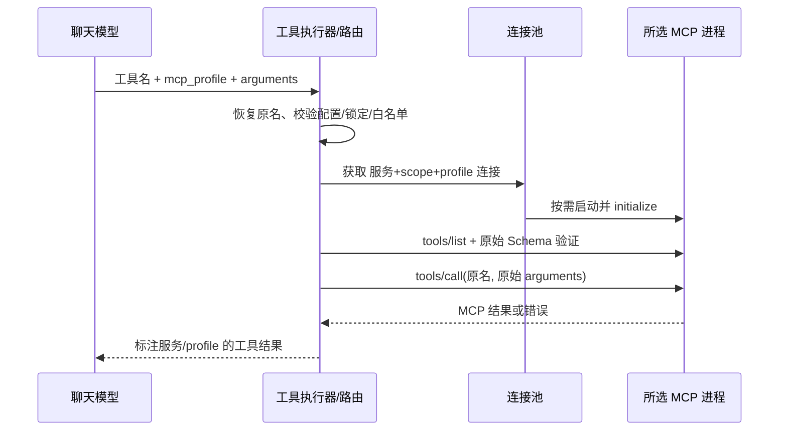

# 通用 MCP 连接 profiles

## 采用的方案

**一个配置服务、一套逻辑工具、多个可独立运行的连接。模型每次显式选择连接。**

`profiles` 定义的是连接启动参数，不是“某些工具名称固定归属某个进程”的分类表。相同的 `browser_click`、`echo` 或数据库查询工具，都可能在多个连接中使用；仅凭工具名无法判断用户想操作哪个浏览器、环境或账号。

- 工具名描述能力；`mcp_profile` 选择本次调用的连接。
- 工具原有业务参数保持原结构，嵌套到 `arguments`。
- 配置中的可选 `tools` 是该 profile 的工具白名单，限制可用能力，不决定默认路由。同一工具可以出现在多个 profile 中。
- 前端 Browser 的“网页操作 / 调试诊断”仍只是模型可用工具的勾选预设，与连接选择相互独立。
- `profiles`、`default_profile`、`locked_profile`、`persistent` 和模型调用封装是本项目客户端功能；发送给第三方服务的仍是标准 MCP 消息。当前传输支持 stdio。

## 通用配置示例

在 `setting/mcp_servers.json` 的 `servers` 内配置：

```json
"Example": {
  "type": "stdio",
  "command": "python",
  "args": ["mcp_server/example.py"],
  "env": {"COMMON_SETTING": "shared"},
  "persistent": true,
  "default_profile": "test",
  "profiles": {
    "test": {
      "label": "测试环境",
      "description": "用于开发与验证",
      "env": {"SERVICE_ENV": "test"}
    },
    "production": {
      "label": "生产环境",
      "description": "仅用于用户明确指定的生产任务",
      "env": {"SERVICE_ENV": "production"},
      "tools": ["read_status"]
    }
  }
}
```

这只是字段示例；需替换为真实服务支持的脚本、环境变量与工具名称。其他服务不需要采用 Browser 的名称、工具前缀或 profile ID。

### 字段规则

| 字段 | 行为 |
| --- | --- |
| `profiles` | 非空对象；ID 为 1–64 位字母、数字、下划线或连字符 |
| `label` / `description` | 向模型与界面解释连接用途；不要在此填写凭据 |
| `command` / `type` | profile 可覆盖公共配置；当前 type 只能是 stdio |
| `args` | 不填写则继承公共 args；填写则**整体替换**，空数组表示不带参数 |
| `env` | 继承后端环境，合并公共 env 与 profile.env，同名以后者为准；键和值均为字符串；支持 `{temp}` 与系统环境变量展开 |
| `persistent` | profile 可覆盖公共值；true 复用进程，省略或 false 每次调用新建连接 |
| `tools` | 可选原始工具名白名单；省略时允许该连接实际提供的全部工具，空数组禁用全部工具；不支持通配符 |
| `default_profile` | 直接调用未指定 profile 时的默认连接；多个 profile 时需配置默认值，单个可省略 |
| `locked_profile` | 可选的服务级固定连接；覆盖默认值，显式请求其他连接也会拒绝 |

不读取任意模型传入的 command、env 或启动参数。模型只能在配置允许的连接中选择。profile 是连接与工具可用范围的边界，不能替代服务自身的权限控制。

未配置 profiles 的 MCP 保持原有扁平工具参数和生命周期。需要只有一个原生启动配置时，删除 profiles/default_profile/locked_profile，并在顶层填写完整 args/env 即可。

## 从模型调用到返回结果

### 1. 工具发现

项目读取服务配置，校验默认值与锁定值，然后分别解析各 profile 的有效启动配置，执行 MCP initialize 与 tools/list；分页工具清单按游标读取。不执行网页点击或其他业务工具。

锁定服务只发现固定的 profile。未锁定时发现各连接，按原始工具名称合并为一份逻辑清单。同一个 Browser 目前仍只显示 25 项，而非两份 25 项。

工具只列出真正提供它、且通过白名单筛选的 profile。某个连接发现失败会记录 profile_status；其工具不会被误标为在失败连接中可用。所有连接均失败则整个服务发现失败。全局工具发现仍受原有发现超时与缓存机制约束。

发现结果进入现有内存工具注册表与 TTL 缓存；执行调用时重新读取配置并检查连接及白名单，配置变化还会触发发现刷新。内存中的工具索引不保存“工具名固定归属某个 profile”的规则。

### 2. 提供给模型的 Schema

例如模型看到的 `browser_tabs` 参数：

```json
{
  "mcp_profile": "extension",
  "arguments": {"action": "list"}
}
```

模型定义要求这两个字段均提供。工具说明包含 profile 的 ID、名称和用途；枚举限制为此工具可用的连接。业务参数在 `arguments` 内仍使用服务返回的原始 Schema。

这样能避免第三方工具自身也包含 `mcp_profile` 或 `arguments` 字段时发生重名。例如原生工具参数可为 `arguments: {"mcp_profile":"业务值"}`，外层 `mcp_profile` 仍只负责选连接。

若不同连接的同名工具具有不同 Schema：参数分支用 anyOf 描述，并注明适用 profile；相同 Schema 去重。嵌入后重新定位本地 JSON Pointer `$ref`，保留 `$defs` 与约束。执行前仍按所选连接重新读取的原始 Schema 校验，不能用另一 profile 的合法参数绕过验证。远程 Schema 引用不下载。

### 3. 调用解析与约束检查

工具执行器按注册表把模型工具名恢复为 `(服务 ID, 工具原名)`。跨服务重名仍采用现有的稳定合格名；profiles 不增加新工具别名。

MCP 客户端解析外层封装，检查 profile 是否存在、是否与 locked_profile 冲突、是否允许该工具，以及 arguments 是否为对象。直接代码调用可省略外层 mcp_profile 使用默认值，或传入同名 Python 关键字参数；若两处同时提供，必须一致。业务字段不能继续放在封装外层。

### 4. 查找或创建进程

聊天中按 `(服务 ID, session_scope, profile ID)` 建立连接池。session_scope 沿用现有聊天 worker、父/子智能体隔离策略。

- `persistent=true`：首次使用该 profile 时启动进程、握手，后续复用同一个连接和串行调用队列。
- `persistent=false`：本次调用新建连接，完成后关闭。
- 两个 profile 可同时保留；切换 profile 不会关闭另一个正常连接。
- 有效启动配置改变时，该 profile 的旧连接被替换；其他配置未变的连接继续复用。
- 连接级状态独立，但如果两个配置指向同一数据库、文件或真实浏览器页面，外部状态仍可能共享。

### 5. 标准 MCP 调用

重新读取所选连接的工具清单，校验该工具存在，并用它当前的原始 Schema 验证业务参数，然后发送：

```json
{
  "method": "tools/call",
  "params": {
    "name": "browser_tabs",
    "arguments": {"action": "list"}
  }
}
```

第三方服务不会收到项目的路由字段；服务实现不需要知道 Ytools 的 profiles。

### 6. 返回结果与失败处理

服务返回标准 MCP content / structuredContent / isError，由现有解析链处理文本、图片等结果，再标注归属：

```text
[MCP 服务: Browser; profile: extension]
...原始工具结果...
```

随后作为工具结果送回模型，模型继续判断下一步。工具执行错误保持错误返回，不把失败解释为成功。超时或取消只清理当前 profile 的常驻连接；连接丢失后下一次调用可重建，扩展可能需要重新授权。不会因为连接失败、工具不存在或参数错误而自动改用其他 profile。



Chat Completions、Messages、Responses 共用此注册和执行链；区别仅在各自模型 API 的工具声明/结果格式转换。profiles 不增加某一种 API 专属路由，也不修改系统提示词；模型通过工具说明与参数 Schema 获知连接选择方式。

## Browser 的具体效果

当前 Browser 已迁移为 `default_profile=isolated`、`profiles.isolated` 和 `profiles.extension`，保留当前配置的 Edge 通道与已选工具。

- isolated 的 args 显式含 `--isolated --headless`，extension 显式含 `--extension`；args/env 的差异写在配置文件中，路由层不再根据 Playwright 工具名称或浏览器模式拼装启动方式。
- 两个 profile 的输出目录分别配置；模式环境变量显式覆盖，避免父进程的 Playwright 标记改变连接方式。
- 扩展服务可在工具发现时返回清单；首次业务调用仍需用户在浏览器授权并选页。
- 用户可说：“用已打开网页的连接，列出标签页并操作标题为 XXX 的网页。”模型应使用 extension；开发测试则明确使用 isolated。
- 指定 profile 只选连接，具体页面仍需 browser_tabs 列表与选择；先核对标题/URL，获取新快照再操作，不跨连接复用元素引用或标签索引。
- 识别 Playwright 的代码只提供浏览器提示和冲突参数校验，不负责通用连接路由。

## MCP 测试界面

GET /tools/diagnostics 返回公开的 mcp_profiles/default_profile/locked_profile；不返回 command、args、env。参数预填表单仍由所选连接原生 Schema 生成。

POST /tools/diagnostics 示例：

```json
{
  "server_id": "Browser",
  "mcp_profile": "extension",
  "action": "call",
  "tool_name": "browser_tabs",
  "arguments": {"action": "list"},
  "timeout_seconds": 120
}
```

HTTP 接口本身已包含顶层 arguments，因此不再套模型工具的第二层封装。JSON 编辑与表单均可使用；切换 profile 会清空当前工具清单和结果，工具选择与草稿按“服务＋profile＋工具”分别保留。固定连接外的选项禁用，后端也会拒绝绕过。

每次诊断独立启动、结束后释放，不复用聊天连接；不能靠逐项诊断维持有状态网页工作流。工具列表接口另提供每个逻辑工具支持的 mcp_profiles、schema_variants 和各连接发现状态。

## 使用与验证

运行中的任务结束或停止后重启后端，再刷新前端。旧浏览器专用路由字段已移除，不提供旧调用参数兼容；历史工具结果不被改写，后续调用使用新 Schema。首次新连接仍需正常授权。

关键测试：`test/test_mcp_profiles.py` 验证非浏览器服务、配置继承/覆盖、锁定、白名单、发现合并、不同 Schema、本地引用、同名业务字段、真实 stdio 双进程、复用与配置变化重连；浏览器集成测试另覆盖 scope、超时隔离及原始参数转发。前端测试覆盖连接切换、草稿隔离与固定连接。
