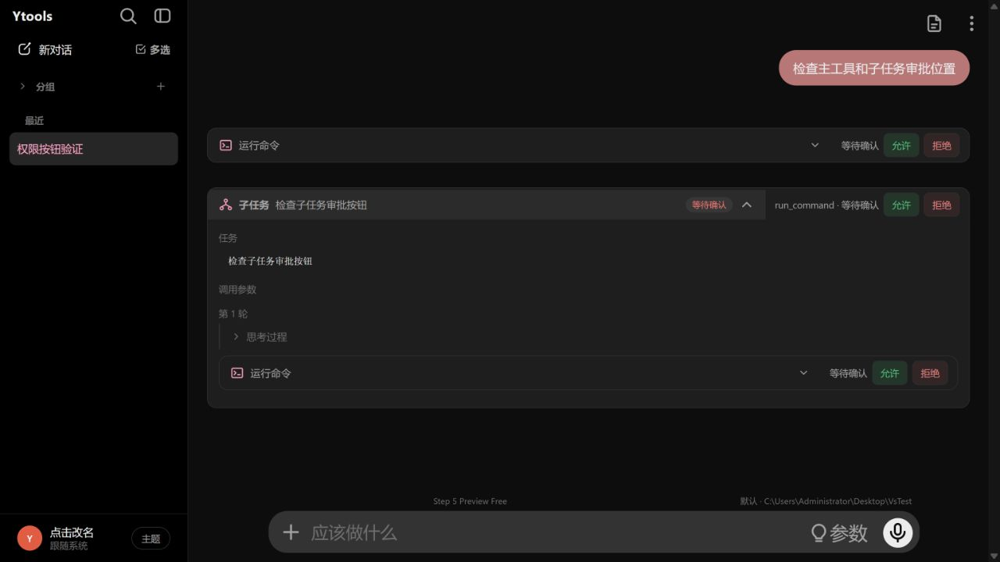
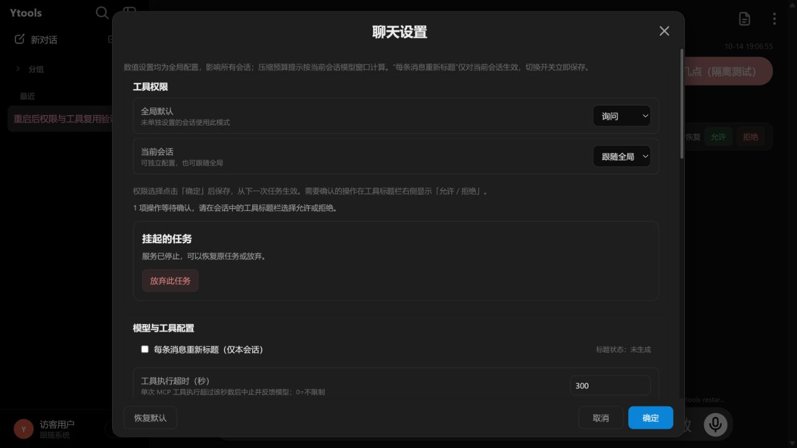
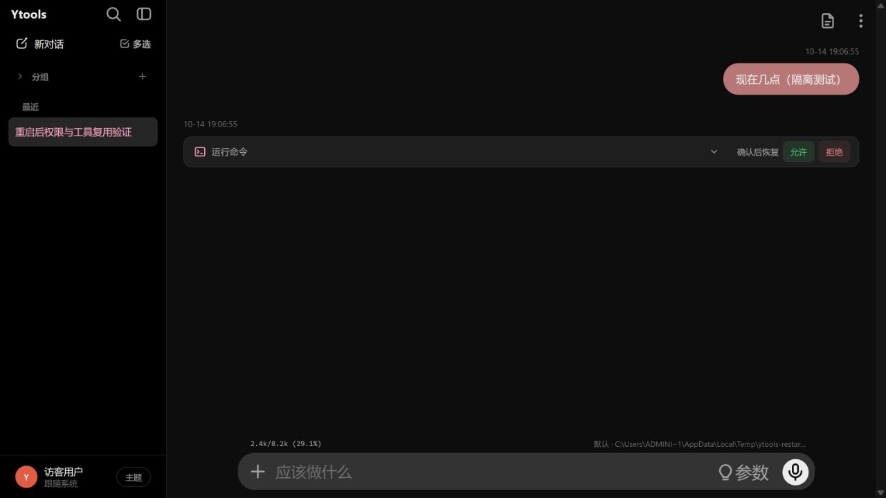

# 工具权限使用与实现说明

2026-10-14。已接入主智能体、子智能体、会话 worker，以及 Chat Completions、Messages、Responses 的工具结果闭环。

## 使用方式

启动后端后，打开 `http://127.0.0.1:48621/ui/`，或直接打开本地 H5 页面。按后续需求已移除控制码、配对界面及权限接口的 Bearer 校验，重启后无需重新连接权限控制。左上角不提供权限按钮，也不会自动弹出独立审批窗口。

页面不需要安装新依赖。网络失败时显示具体错误；保存失败不会把用户已选模式改回旧值。审批仍由后端校验会话、调用 ID、参数和执行代次，模型文本不能批准工具调用。

聊天设置提供：

- **全局默认**：询问、完全控制；初始默认询问。
- **当前会话**：跟随全局、询问、完全控制；未设置的会话跟随全局。
- 选择权限后点击底部“确定”保存，取消/关闭不会提交权限选择。
- 挂起任务的恢复/放弃入口；执行结果未知时显示原因，禁止自动重跑。

待确认操作在**工具块标题栏右侧**显示“允许 / 拒绝”。展开工具块查看完整参数，悬停审批区查看实际路径和工作目录。子智能体顶部标题栏也显示其待确认操作，内部工具块同步提供按钮；任一处点击都处理同一审批，提交中两处同步禁用。拒绝仅拒绝本次工具调用并继续任务。

刷新页面后从后端查询当前有效审批，再绑定到对应工具调用；历史审计记录本身不能授权，也不再单独显示“执行确认”块。SSE 保留调用 ID；旧增量缺少 ID 时，按本轮 index 或未绑定的声明块认领原工具，避免重复建块。调用 ID 和会话轮次用于区分同名工具与历史重复 ID，子任务审批附带父轮次、子轮次及父派发调用 ID。网络失败保留按钮供重试，迟到查询响应不会让已决定的审批重新出现。服务重启后挂起审批也在原工具标题栏重新确认。

设置在后端持久保存，不跟随会话导入、导出。每个任务固定其启动时的模式和实际工作目录，设置改变从下一次任务生效。恢复任务沿用原任务的模式和目录。

## 询问规则

| 操作 | 行为 |
|---|---|
| 启动 `run_command`（前台、后台均包含） | 每次确认，展示完整命令、实际 shell、工作目录和调用参数 |
| 调用 MCP 工具 | 每次确认，包括只读工具；确认与具体服务、工具、参数绑定 |
| 内置读、写、编辑文件，读取本地文档/媒体 | 实际目标在当前工作目录或子目录内时自动通过，目录外先确认 |
| 搜索文件 | 外部搜索根先确认；目录内搜索遇到越界链接或受保护的控制文件时跳过，并返回 `skipped_permission` 和不完整扫描提示 |
| HTTP(S) 媒体读取/自动展示 | 确认具体来源；工具下载只允许同来源重定向，跨来源需重新调用确认；预览代理拒绝重定向 |
| 当前会话已经上传的文件、`media://` 副本 | 保留原有会话归属检查，不重复确认 |
| todo、ask_user、派发子任务 | 本身无需确认；子任务实际工具调用仍按同一规则处理 |
| 已有后台命令的 poll/stop | 无需再次确认，保留会话归属和禁止夹带新执行参数的校验 |

询问模式下，权限实现文件、控制配置、`history_files/state` 和 `history_files/sidecars` 等控制资源需要单独确认；不能通过一次目录内搜索获得这些资源的读取权限。完全控制直接通过新增权限层，原来的工具可用性、参数和大小限制继续生效。

路径按实际解析结果判定，避免目录字符串前缀、`..`、符号链接、Windows 联接等造成越界。新建文件也检查目标及真实父路径；实际读取和写入入口会再次检查授权目标。MCP 服务配置在计划中记录指纹，执行前发生变化则阻止执行。

模型输出的本地媒体标签还会走后端边界检查。未经确认的外部资源请求得到 403，不读取正文；用户批准后取得绑定会话、来源、当前服务启动和有效期的短期票据。音视频 Range 请求属于该次展示。询问模式的媒体预览代理上限 32MB，超限需通过读取工具处理。完全控制时，网络媒体由后端校验当前模式后跳转至原地址；前端缓存的模式不作为自动访问的授权依据。

## 等待、停止与恢复

审批等待是异步 Future，不占用工具执行线程；worker 收到决定后经命令 Pipe 唤醒对应等待器。所有同批调用的审批先提交数据库，再等待决定；不同子任务有独立审批。关闭弹窗、切换会话或断开页面不会自动批准或拒绝。审批不设置短期等待超时，子任务的活动执行预算扣除等待确认时间。

等待过程中关闭后端或 worker 意外退出后，原任务成为挂起状态。重新启动服务后，在原会话工具标题栏重新允许/拒绝即可继续。恢复会：

1. 接管同一逻辑任务并生成新的执行代次，使旧审批失效。
2. 恢复原问题、模型完成结果、调用批次、主/子任务上下文和远程协议状态。
3. 本地回放产生工具调用的那次模型输出，不重新发送用户问题或重复请求该模型输出。
4. 复用已落盘的工具/子任务结果，继续尚未执行的调用；恢复审批必须重新确认。
5. 对参数、模型、工具配置或实际路径的变化进行校验，不能将旧决定转移给改变后的调用。

恢复启动时先按执行台账回退原生协议工具槽：无执行记录、结果已缓存或可重派发的 running/unknown 槽位回到待执行并重新确认；执行意图已写入但结果未知的槽位保持未知，仍然拒绝重跑。恢复轮询超时或 worker 已退出时释放本次派发回挂起，可重试恢复，不会留下无人看管的 running 任务。

没有待确认卡片但仍有可恢复检查点时，面板提供“恢复原任务”。挂起任务未处理时，后端会阻止同会话的新任务覆盖恢复上下文，用户可先恢复或放弃。

**执行结果未知**：工具开始前先写入执行意图。如果进程在执行期间退出，而完成结果尚未提交，后端不能判断外部副作用是否已发生，因此拒绝自动重跑。请核对实际文件、命令或外部服务结果，再放弃并重新规划。正常停止/放弃会取消审批，迟到的批准不能继续执行。已经启动的后台命令仍按原终端功能管理。

用户拒绝会产生带原始 tool call ID 的错误结果，继续交给模型；三个模型协议均保持调用/结果配对。放弃时关闭已知未执行的原生协议工具槽。权限事件保存在历史中作审计，回放历史不会恢复批准能力。单独停止子任务后，其待确认审批同步失效，父任务仍可继续。

待恢复轮次可能尚未写入主 JSONL。历史显示和删除预演共用检查点轮次口径，支持从侧车及 SQLite 恢复。预演保持只读；正式删除前先校验轮次有效，再停止原任务并以 stopped 收尾，随后删除。编辑重发会先确认停止待恢复任务，保存已有轨迹，再进行删除/替换，避免显示第 1 轮而删除接口认定仅有 0 轮。

## 存储与入口

权限默认值、会话覆盖、审批、任务检查点和执行台账统一放在 `history_files/state/permission_runtime.sqlite3`，使用 SQLite WAL 与事务提交。权限选项继续以 SQLite 为唯一真源，不拆分到 `.env` 或会话 JSONL。等待任务保存完整恢复上下文；任务完成、失败或放弃后清除恢复快照和工具结果正文，保留轻量审批记录。删除会话会清理该会话的权限覆盖和记录，保留全局设置。

分享 ZIP 会附带仅所选会话权限的 SQLite 快照，导入弹窗展示「询问／完全控制／跟随本地全局设置」，确认导入后按最终会话 ID 合并配置；本地全局和其他会话不变。全局默认、历史批准、待审批、恢复检查点、执行台账不导入，历史审批 ID 也不随聊天携带，不能在接收端恢复或批准发送端的任务。单独 JSONL 与旧包不携带权限配置。详见 [会话分享与权限迁移](session_sharing.md)。

升级前停止旧后端，再启动新版本：当新路径不存在而 `history_files/sidecars/permission_runtime.sqlite3` 存在时，自动通过 SQLite backup API 迁移，包含已提交的 WAL 数据。迁移先生成独立快照、整理空闲页、校验完整性，并在 `history_files/state/backups/` 留下单文件备份，再原子发布新数据库；成功后移除旧文件。失败时保留旧库并报错，不以空库覆盖旧配置。线程锁与跨进程锁避免多个新 worker 重复迁移；新路径已有数据库时直接使用，不从旧库自动覆盖或合并。旧文件被占用无法移除时保留并记录日志。

`state/` 是持久数据目录，需要备份；会话分享包不包含它。约300 MB的会话搜索数据库是另一份 `sidecars/history_search.sqlite3`，属于可从 JSONL 重建的缓存；详情见 [本地数据存储说明](local_data_storage.md)。

| 文件 | 职责 |
|---|---|
| `memory/permission_store.py` | 配置、审批状态、恢复代次、检查点、工具执行台账 |
| `factory/agent_runtime/permission_policy.py` | 从实际工具和参数生成调用计划、路径与服务指纹 |
| `factory/agent_runtime/permission_runtime.py` | 主/子任务共享的审批等待、执行所有权、读写/下载守卫、立即保存工具完成结果 |
| `factory/chat_factory.py`、`sub_agent.py` | 执行前接入审批，持久检查点与本地回放恢复 |
| `factory/session_worker.py` | worker 审批 IPC、服务关闭时挂起任务 |
| `routers/tool_approval_router.py`、`permissions_auth.py` | 配置/审批/恢复接口、媒体读取票据（仅内部签名密钥，无用户控制码） |
| `H5/js/app/permissions.js`、`tool_approval_state.js` | 聊天设置权限、工具与子任务顶部审批、共享提交锁、恢复/放弃、媒体审批；异步返回和会话切换时丢弃过时结果 |

接口：

- `GET /chat_config/permissions?session_id=...`：有效模式及全局/会话值；无需控制码。
- `POST /chat_config/permissions`：`{mode, session_id?}`；会话 `mode:null` 清除覆盖。
- `GET /tool_approvals/pending?session_id=...`：待确认卡片及挂起任务；可重复传 `approval_ids`（最多200个）查询当前页面已有审批的状态，`states` 包含已取消/已结束状态及执行记录状态。
- `POST /tool_approvals/{id}/decision`：`{session_id, epoch, decision:"approve"|"deny"}`。
- `POST /tool_approvals/tasks/{id}/resume`、`/cancel`：`{session_id}`。
- `POST /tool_approvals/preview`：`{session_id, source}`；取得预览审批或已允许来源的票据。
- `GET /permissions/media?session_id=...&source=...&grant=...`：受控媒体预览。

权限接口无需控制码，判断和执行权限由后端决定；前端按钮不具有独立放行能力。多页面提交按审批 ID、会话和执行代次校验，不重复执行工具。

## 边界与验证

这是应用内的执行确认，不能代替操作系统沙箱。用户批准命令/MCP 后，它们具有当前系统用户的能力；本版本也不保证任意外部服务的“恰好执行一次”，对结果未知的情况采用停止恢复的策略。当前仅提供逐次批准/拒绝，没有目录永久允许或批量全部允许。

自动化覆盖：全局与会话配置、授权矩阵、链接越界、控制文件搜索过滤、媒体来源与票据、批准/拒绝、调用缓存、主/子任务恢复、等待预算、旧代次决定、未知执行阻止恢复。真实 Windows spawn worker + Pipe 测试覆盖关闭进程、重新启动、HTTP审批及只执行一次；模型使用测试替身，命令额外使用真实 PowerShell `Get-Date` 验证，不使用真实密钥。

审批等待以数据库中的决定为准：IPC即时唤醒，通知丢失时最多约1秒后读取已保存决定继续执行。恢复派发失败且尚未被worker接管时释放主进程所有权，保留检查点供重试。已取消任务不能通过旧审批恢复，前端显示明确的取消/失败状态；工具已有输出时，审批状态不会覆盖输出。打开会话时同步已有审批的后端状态，历史中的 `requested` 事件不直接恢复可操作按钮。

会话运行状态接口与编辑/删除检查共用实际 worker/stream 任务状态。停止信号只保存在当前生成任务的 stream/worker 中，历史管理器仅保存历史和上下文；挂起的权限检查点仍由正式删除流程先停止并收尾。

同批混合决定按工具调用 ID 独立处理：本批审批均选择后，只执行获准调用；拒绝项返回 `PERMISSION_DENIED`、`executed:false`，作为对应调用的工具结果交给模型继续处理。拒绝项不发送 `tool_start`，前端立即显示“已拒绝，本次工具不会执行”并停止转圈。回归测试覆盖两种允许/拒绝组合、正反点击顺序、先处理第二条审批，以及服务挂起恢复；在隔离目录用真实 PowerShell 写入标记验证拒绝项没有执行。
